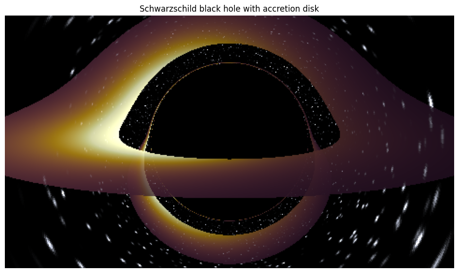
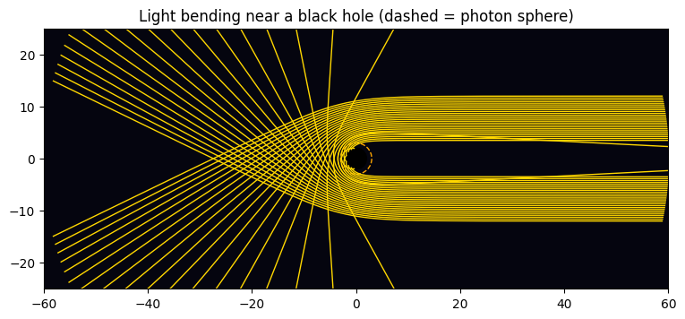
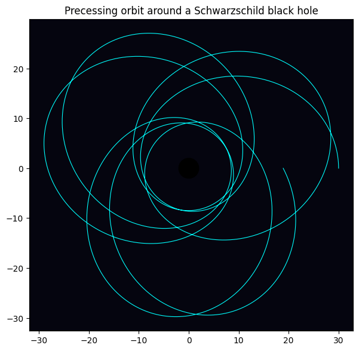
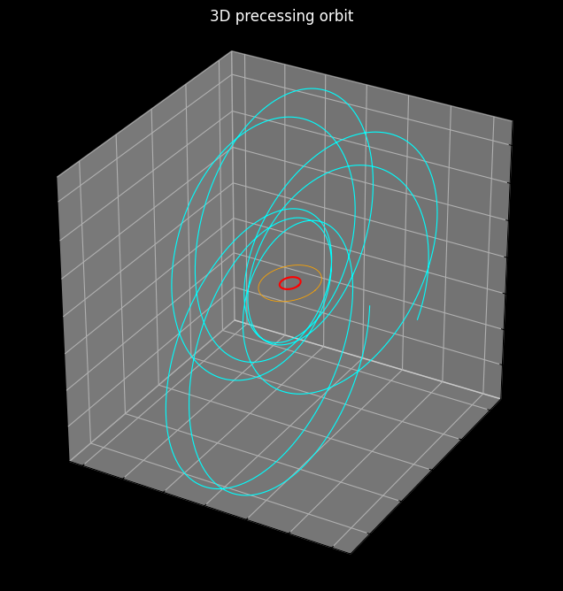

# Schwarzschild Black Hole Simulation

Python notebooks that simulate a non-rotating (Schwarzschild) black hole: how it bends light, how orbits around it precess, and what it looks like when ray-traced with an accretion disk. Everything uses only **NumPy, SciPy and Matplotlib**, so it runs on a laptop CPU or in Google Colab with no GPU and no extra setup.



## Notebooks

| Notebook | What it shows | Open in Colab |
| --- | --- | --- |
| [`blackhole_simulation.ipynb`](blackhole_simulation.ipynb) | 2D light bending and orbit precession | [](https://colab.research.google.com/github/ujjwalsoni3000-alt/blackhole-Schwarzschild-/blob/main/blackhole_simulation.ipynb) |
| [`blackhole_3d.ipynb`](blackhole_3d.ipynb) | Ray-traced image with accretion disk, multiple viewing angles, 3D orbit | [](https://colab.research.google.com/github/ujjwalsoni3000-alt/blackhole-Schwarzschild-/blob/main/blackhole_3d.ipynb) |

## What it does

**1. Light bending.** Light rays are traced past the black hole. Rays with an impact parameter below 3√3 M ≈ 5.2 M are captured, and the rest curve around it and escape. The photon sphere sits at r = 3M.



**2. Orbit precession.** A massive particle's orbit is an ellipse that rotates a little on every lap. This is the same relativistic effect that shifts the orbit of Mercury.



**3. Ray-traced black hole.** For every pixel a light ray is shot backwards from the camera. Gravity bends the ray, and it is followed until it either
- falls into the horizon (black pixel),
- crosses the accretion disk (glowing pixel, with Doppler brightening so one side of the disk looks brighter), or
- escapes to the starfield.

The disk's far side appears bent over the top and under the bottom of the hole, as in real images of black holes.

**4. 3D orbit.** The precessing orbit is drawn in 3D, with the horizon and the innermost stable orbit marked.



## The physics

Units are **G = c = M = 1**, so the event horizon is at r = 2 and the disk's inner edge is at r = 6 (the innermost stable circular orbit). With u = 1/r and φ as the orbit angle, the equations integrated are:

| Object | Equation |
| --- | --- |
| Light (photon) | d²u/dφ² = −u + 3Mu² |
| Massive particle | d²u/dφ² = M/L² − u + 3Mu² |

`L` is the particle's angular momentum. The extra 3Mu² term (compared with Newtonian gravity) is what bends light and causes precession. Each ray stays in one plane through the black hole, so the 3D renderer integrates all pixels at once with a vectorized RK4 stepper and then converts back to 3D to test the disk crossing in the z = 0 plane.

## Run it

**In the browser:** click an "Open in Colab" badge above, then Runtime → Run all.

**Locally:**

```bash
git clone https://github.com/ujjwalsoni3000-alt/blackhole-Schwarzschild-.git
cd blackhole-Schwarzschild-
pip install numpy scipy matplotlib jupyter
jupyter notebook
```

The ray-traced render takes roughly 10 to 40 seconds at the default 480 x 270 resolution, depending on your machine.

## Things to tweak

In `blackhole_3d.ipynb`, the `render()` function accepts:

| Parameter | Meaning | Default |
| --- | --- | --- |
| `elev` | Camera angle above the disk plane, in degrees | 10 |
| `D` | Camera distance from the black hole | 60 |
| `fov` | Field of view (zoom) | 28 |
| `r_in`, `r_out` | Inner and outer radius of the disk | 6, 16 |
| `alpha` | Disk opacity | 0.85 |
| `W`, `H` | Image resolution (larger is slower) | 480, 270 |
| `dphi`, `max_steps` | Integration step and step limit (accuracy and speed) | 0.02, 450 |

In `blackhole_simulation.ipynb`, change `L` to alter the shape of the orbit, and the range of impact parameters `b` to trace more or fewer rays.

## Roadmap

- [ ] Spinning (Kerr) black hole
- [ ] Animated camera or orbit (`matplotlib.animation.FuncAnimation`, or a movie by looping `elev`)
- [ ] GPU version (for example CuPy)
- [ ] Measure the precession angle per orbit and compare it with the analytic value

## License

No license has been chosen yet. Add a `LICENSE` file (for example MIT) to state how others may use this code.
